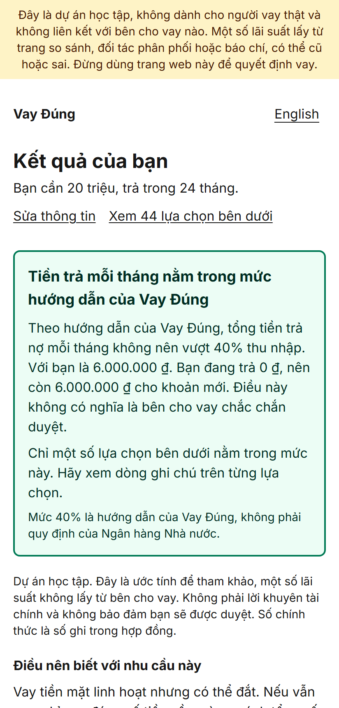
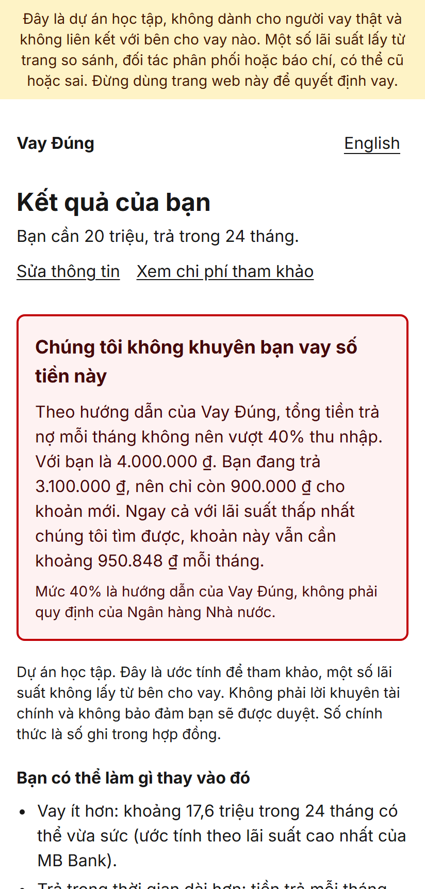
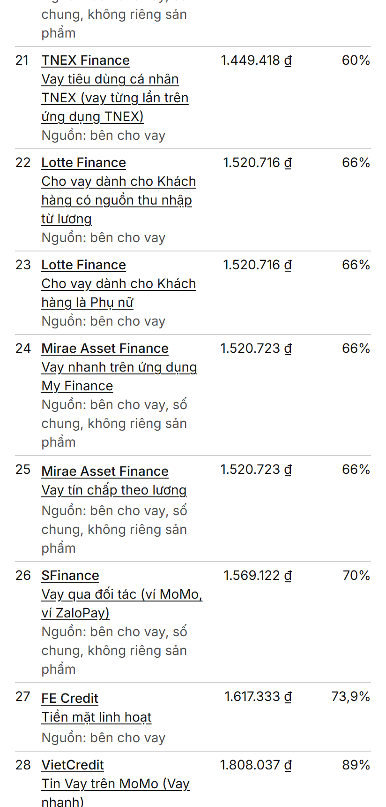

# Vay Đúng: an honest loan comparison tool for Vietnamese borrowers

*Vay Đúng ("borrow right") turns confusing Vietnamese loan offers into one comparable number, ranks them by real cost and fit, and tells the borrower when they shouldn't borrow at all.*

**Student project, not a service for real borrowers.** Built by Nguyễn Vân Anh, November 2026.

- **Code:** https://github.com/vanhxoai/vay-dung
- **Live demo:** https://vay-dung.vercel.app (Vietnamese by default, English at `/en`). The rates were collected in November 2026. After 90 days the site keeps working, but it labels those figures as old (see [Archive mode](#archive-mode)).
- **Walkthrough video (66 s):** [docs/portfolio/vay-dung-walkthrough.mp4](docs/portfolio/vay-dung-walkthrough.mp4)
- **Screenshots:** [docs/portfolio/screenshots/](docs/portfolio/screenshots/)

| Results and verdict | "Don't borrow" | Ranking table |
|---|---|---|
|  |  |  |

## The problem

Vietnamese lenders quote rates in ways that can't be compared. Some quote a flat rate (*lãi phẳng*), others a reducing-balance rate (*dư nợ giảm dần*), some per month and some per year, and fees and insurance come on top. A "1.41% a month" flat loan sounds cheaper than a "25% a year" reducing loan, but it isn't. Borrowers also don't know what they'd qualify for, can't tell licensed lenders from illegal apps, and rarely hear "this is too much for you."

## What the app does

1. **Asks about the need:** purpose, amount, term, income, existing debt, age and income papers. All of this stays in the browser. Nothing is sent to a server or stored, and there's no login.
2. **Costs every loan the same way.** It builds the real cash flows, including fees deducted from the payout and mandatory insurance, and solves for the internal rate of return. The result is a true yearly rate, monthly payment, total repaid and total cost.
3. **Ranks by fit first, then cost.** Can you afford it at the lender's highest rate? Do you have the papers it needs? Then cheapest real rate first. It never ranks by who pays, because nobody does.
4. **Gives a verdict.** If total debt payments would exceed 40% of income (the app's own guideline; the State Bank of Vietnam sets no limit), it says *"Chúng tôi không khuyên bạn vay số tiền này"* (we don't recommend borrowing this) and suggests a smaller amount or a longer term.
5. **Explains itself.** Each card says why it sits where it does, names the source of every figure with a link and date, and shows the month-by-month schedule. The full method is published at `/cach-xep-hang`, and all the data is at `/du-lieu`, with a CSV download.
6. **Checks lenders.** `/kiem-tra` matches a name against the State Bank of Vietnam's list of licensed institutions and flags common scam signs.

## The finance core

`src/lib/finance/` is pure TypeScript with no UI code. Money is held as whole đồng, never floating point.

Here is an example from the tests. FE Credit advertises **1.41% a month, flat**: 10,000,000 đ over 12 months.

| | |
|---|---|
| What the ad suggests | 1.41% × 12 = 16.92% a year |
| Cash flows | +10,000,000, then −974,333 × 11 and −974,337 |
| Monthly IRR | 2.4909% |
| **Real yearly rate (nominal, monthly IRR × 12)** | **29.89%** |
| Effective yearly rate ((1+r)¹² − 1) | 34.35% |

The IRR uses Newton's method with a bisection fallback. Every formula has hand-checked unit tests. A separate Python script ([scripts/check/](scripts/check/)) re-derives the results independently. The last run covered 1,628 loan cases and matched to the đồng.

## Data

- **82 products from 20 licensed lenders.** Every figure has a source URL, a retrieval date and a confidence level. Unknown values show as *"chưa rõ"* (unknown), never a guess.
- **Licensing:** a lender appears only if it's on the State Bank of Vietnam's published lists ([data/licensed-institutions.json](data/licensed-institutions.json)).
- **Store:** one Excel workbook ([data/store/loan-data.xlsx](data/store/loan-data.xlsx)). `npm run data:import` validates every row with Zod and writes the snapshot the app reads.
- **Live rates:** the server can overlay rates from a published Google Sheet (any CSV URL). The `/vay` page re-reads it about every 5 minutes, so a rate change appears in about 3 minutes without a redeploy. Bad rows are skipped. If the feed fails or takes over 10 seconds, the app falls back to the imported data.

```
loan-data.xlsx ──npm run data:import──▶ snapshot.json ──▶ server ──▶ browser (costs, ranks, verdict)
                                                           ▲
                          Google Sheet (CSV) ── rates only ┘
```

**A research finding:** lenders' own rate documents were often far above the figures on comparison sites. So the app ranks on the lender's published top rate and labels every figure that comes from anywhere else.

## Archive mode

Figures older than 90 days would normally drop out of the ranking. With `ARCHIVE_MODE` on ([src/config/site.ts](src/config/site.ts)), they stay ranked under a dated "old data" notice. Each affected card is flagged, and an old figure can never produce a green "you can afford this" verdict. This keeps the demo usable after the data stops being maintained.

## Quality

- 254 unit tests (Vitest) and 140 browser tests at phone size (Playwright).
- Independent Python re-derivation of the cost engine.
- Review passes for compliance (misleading claims, disclosure, privacy) and QA (a first-time user on a phone) before each release.
- 69 recorded design decisions with reasons: [docs/DECISIONS.md](docs/DECISIONS.md). Build history: [docs/PROGRESS.md](docs/PROGRESS.md).

## Tech

Next.js 16 (App Router), TypeScript (strict), Tailwind CSS, next-intl (Vietnamese and English), Zod, Vitest, Playwright, and exceljs. It's deployed on Vercel's free plan, with no database.

## Run it locally

```bash
npm install
npm run dev          # http://localhost:3000
npm test             # unit tests
npm run test:e2e     # browser tests
```

## Limitations

- One-off mandatory fees aren't in the cost yet; the app says so.
- Many figures are company-wide ranges or come from secondary sources. Each card says which.
- Not financial advice, and not a guarantee of approval.
